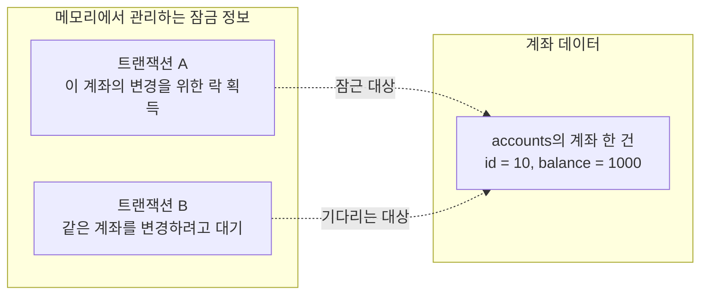

## 락의 개념과 동작(Lock)

락은 ==여러 트랜잭션이 같은 데이터를 동시에 다루면서 데이터가 잘못되는 것을 막기 위한 장치==이다.
한 트랜잭션이 데이터를 처리하는 동안, 충돌하는 다른 작업을 기다리게 하여 데이터를 보호한다.

### InnoDB의 락 구현(Lock System)

핵심은 **==메모리에 “누가 어떤 데이터를 잠갔고, 누가 기다리고 있는지” 기록한다==**는 것이다.
이 기록을 확인하여 다른 트랜잭션의 작업을 허용하거나 기다리게 한다.

예를 들어 A와 B가 모두 `accounts`의 `id = 10`인 계좌 잔액을 변경하려고 한다고 가정한다.
A가 먼저 변경을 위한 락을 획득했다면, 잠금 정보를 다음과 같이 관리한다고 생각할 수 있다.

| 대상            | 트랜잭션 | 하려는 작업 | 상태   |
| ------------- | ---- | ------ | ---- |
| `id = 10`인 계좌 | A    | 잔액 변경  | 락 획득 |
| `id = 10`인 계좌 | B    | 잔액 변경  | 락 대기 |

아래 그림은 실제 계좌 데이터와, 그 계좌에 대한 잠금 정보를 구분하여 보여준다.



**B를 어떻게 기다리게 하는가?**

B가 같은 계좌를 변경하려고 하면, InnoDB는 잠금 정보를 확인한다. A가 이미 변경을 위한 락을 가지고 있으므로 B의 요청을 대기로 기록하고, B의 SQL을 실행하던 작업을 멈춰 기다리게 한다.

A가 `COMMIT` 또는 `ROLLBACK`으로 트랜잭션을 끝내면 해당 락을 해제한다. 이후 InnoDB는 B가 락을 획득할 수 있는지 확인하고, 가능하면 기다리던 작업을 깨워 실행을 이어가게 한다.
이처럼 **잠금 정보를 기록하고, 확인하고, 기다리는 작업을 다시 실행시키는 것**이 락을 구현하는 핵심이다.

**실제 코드에서는 어떻게 표현하는가?**

InnoDB는 `lock_sys`로 잠금과 대기를 관리하고, `lock_t`에 요청한 트랜잭션, 잠금 대상, 잠금 모드, 대기 여부를 기록한다.

레코드 잠금의 대상은 인덱스로 찾은 레코드의 페이지 식별자와 페이지 내부 번호(`heap_no`)로 식별한다.

참고: MySQL 8.4.0 공식
소스 [락 관리 방식 설명](https://github.com/mysql/mysql-server/blob/mysql-8.4.0/storage/innobase/include/lock0lock.h#L55), [잠금 정보를 담는 자료 구조](https://github.com/mysql/mysql-server/blob/mysql-8.4.0/storage/innobase/include/lock0priv.h#L136).

## 공통 실습 환경

**MySQL 8.4 · InnoDB · `REPEATABLE READ`** 기준이다. 별도 연결 A/B를 열고, A에서 실습 테이블을 생성한다.

```sql
CREATE DATABASE IF NOT EXISTS test;
USE test;

CREATE TABLE accounts (
    id INT PRIMARY KEY,
    balance INT NOT NULL
) ENGINE=InnoDB;
```

A/B 각각에서 실행한다. `CONNECTION_ID()`가 서로 다른지 확인한다.

```sql
USE test;
ROLLBACK;
SET SESSION autocommit = 1;
SET SESSION TRANSACTION ISOLATION LEVEL REPEATABLE READ;

SELECT VERSION(), CONNECTION_ID(), @@session.transaction_isolation;
```

- 예제마다 **A/B의 이전 트랜잭션을 모두 종료**한 뒤 준비 SQL을 실행한다. `TRUNCATE TABLE`은 암묵적으로 커밋하므로 트랜잭션 밖에서 실행한다.
- 락 관찰 시 `COMMIT` 직전에서 멈추고 다른 연결에서 충돌하는 SQL을 실행한다. 대기를 확인한 뒤 락을 보유한 연결을 먼저 커밋하고, 대기하던 연결도 트랜잭션을 종료한다.
- 출력 결과는 실제 측정 로그가 아닌 설명용 예시다.

## 공유 락과 배타 락(Shared and Exclusive Locks)

InnoDB의 행 수준 잠금에는 공유 락(S 락)과 배타 락(X 락)이 있다.

- **공유 락(S, Shared Lock)**: 행을 읽기 위해 획득한다. ==다른 트랜잭션의 S 락과는 호환되지만 X 락과는 충돌한다.==
- **배타 락(X, Exclusive Lock)**: 행을 수정하거나 삭제하기 위해 획득한다. ==다른 트랜잭션의 S 락 및 X 락과 모두 충돌한다.==

### 동작과 예제

준비 SQL을 세션 A에서 실행한다.

```sql
TRUNCATE TABLE accounts;
INSERT INTO accounts (id, balance) VALUES (10, 1000);

-- 락 확인: 아래 실습에서 락을 잡은 뒤, A에서 COMMIT 전에 실행
-- LOCK_MODE: S(공유) / X(배타), LOCK_STATUS: GRANTED(획득) / WAITING(대기)
SELECT THREAD_ID, INDEX_NAME, LOCK_TYPE,
       LOCK_MODE, LOCK_STATUS, LOCK_DATA
FROM performance_schema.data_locks;
```

**1. S 락끼리는 호환되고, S 락과 X 락은 충돌한다.**

아래 블록을 순서대로 실행한다. 먼저 **A**에서 S 락을 잡고 커밋하지 않는다.

```sql
-- A
START TRANSACTION;
SELECT id, balance FROM accounts WHERE id = 10 FOR SHARE;
```

**B**의 `FOR SHARE`는 즉시 완료되지만, 이어지는 `UPDATE`는 X 락이 필요하므로 A의 S 락이 해제될 때까지 대기한다.

```sql
-- B
START TRANSACTION;
SELECT id, balance FROM accounts WHERE id = 10 FOR SHARE;
UPDATE accounts SET balance = balance - 100 WHERE id = 10;
```

```sql
-- A: 락 해제
COMMIT;

-- B: UPDATE 완료 후 커밋
COMMIT;
```

**2. X 락은 다른 트랜잭션의 S 락 및 X 락과 충돌한다.**

이번에는 **A**에서 `FOR UPDATE`로 X 락을 잡는다.

```sql
-- A
START TRANSACTION;
SELECT id, balance FROM accounts WHERE id = 10 FOR UPDATE;
```

**B**의 `FOR SHARE`는 A의 X 락 때문에 대기한다.

```sql
-- B
START TRANSACTION;
SELECT id, balance FROM accounts WHERE id = 10 FOR SHARE;
```

```sql
-- A: 락 해제
COMMIT;

-- B: 조회 완료 후 커밋
COMMIT;
```

두 번째 예제를 B의 `FOR SHARE`만 `FOR UPDATE`로 바꾸어 반복하면, X 락끼리도 충돌하여 대기하는 것을 확인할 수 있다.

### 주의점

S/X는 락의 **모드**이고, 레코드·갭·넥스트 키는 락의 **범위**를 설명한다.
특히 순수한 갭 락에는 아래에서 설명하는 별도의 호환 규칙이 적용된다. ==X 락이 있다고 해서 MVCC를 사용하는 일반 조회까지 모두 차단되는 것은 아니다.==

## 의도 락(Intention Locks)

의도 락은 트랜잭션이 테이블 내 개별 행에 S 락 또는 X 락을 설정하려 한다는 사실을 나타내는 테이블 수준의 락이다.
InnoDB는 이를 통해 행 수준 락과 테이블 수준 락이 공존하는 다중 단위 잠금(Multiple Granularity Locking)을 지원한다.

- **의도 공유 락(IS, Intention Shared Lock)**: 개별 행에 S 락을 설정하려는 의도를 나타낸다.
- **의도 배타 락(IX, Intention Exclusive Lock)**: 개별 행에 X 락을 설정하려는 의도를 나타낸다.

### 행 잠금과 테이블 잠금의 관계

InnoDB는 행을 잠그기 전에 테이블에 의도 락을 자동으로 설정한다. 기본 동작은 다음과 같다.

- `SELECT ... FOR SHARE`: 테이블에 IS 락을 잡고, 조회할 행에 S 락을 잡는다.
- `SELECT ... FOR UPDATE`: 테이블에 IX 락을 잡고, 조회할 행에 X 락을 잡는다.

예를 들어 A가 한 행을 수정하며 테이블에 IX 락을 보유하고 있다면, B의 `LOCK TABLES accounts WRITE`는 테이블 전체를 잠그려 하므로 충돌해 기다린다. 반면 B가 다른 행을 수정하기 위해 IX 락을 잡는 것은 가능하다. 실제 행의 충돌 여부는 행 락에서 따로 판단한다.

아래 표의 **S/X는 행 락이 아니라 테이블 전체의 공유/배타 락**이다.

| 기존 락 / 요청 락 | X   | IX  | S   | IS  |
| ----------- | --- | --- | --- | --- |
| X           | X   | X   | X   | X   |
| IX          | X   | O   | X   | O   |
| S           | X   | X   | O   | O   |
| IS          | X   | O   | O   | O   |

O: 함께 획득 가능 / X: 충돌하여 기존 락이 해제될 때까지 대기

테이블 X는 모두와 충돌하고, 테이블 S는 수정을 뜻하는 IX·X와 충돌한다. 의도 락끼리는 호환되며, 실제 행의 충돌은 행 락에서 판단한다.

### 의도 락 정보 확인

이전 A/B 트랜잭션을 종료한 뒤 A에서 실행한다. 행 락과 함께 테이블에 의도 락이 잡히는지 확인한다.

```sql
TRUNCATE TABLE accounts;
INSERT INTO accounts (id, balance) VALUES (10, 1000);

-- 공유 락: TABLE의 IS와 RECORD의 S 확인
START TRANSACTION;
SELECT id, balance FROM accounts WHERE id = 10 FOR SHARE;

SELECT INDEX_NAME, LOCK_TYPE, LOCK_MODE, LOCK_STATUS, LOCK_DATA
FROM performance_schema.data_locks;
COMMIT;

-- 배타 락: TABLE의 IX와 RECORD의 X 확인
START TRANSACTION;
SELECT id, balance FROM accounts WHERE id = 10 FOR UPDATE;

SELECT INDEX_NAME, LOCK_TYPE, LOCK_MODE, LOCK_STATUS, LOCK_DATA
FROM performance_schema.data_locks;
COMMIT;
```

두 경우 모두 `LOCK_STATUS`는 `GRANTED`이며, 레코드의 `LOCK_MODE`에는 `S,REC_NOT_GAP` 또는 `X,REC_NOT_GAP`이 표시된다. `REC_NOT_GAP`은 갭을 제외한 레코드 자체의 잠금이라는 뜻이다.

**테이블 S/X 락 확인**

아래 블록을 A → B → A 순서로 실행한다.

```sql
-- A: 테이블 S 또는 X 락 획득
SET autocommit = 0;
-- 아래 두 문장 중 하나만 실행
LOCK TABLES accounts READ;     -- S 락
-- LOCK TABLES accounts WRITE; -- X 락: 위 READ 대신 실행
```

```sql
-- B: TABLE / S 또는 X / GRANTED 확인
SELECT OBJECT_NAME, LOCK_TYPE, LOCK_MODE, LOCK_STATUS
FROM performance_schema.data_locks;
```

```sql
-- A: 잠금 해제 후 설정 복구
COMMIT;
UNLOCK TABLES;
SET autocommit = 1;
```

`LOCK TABLES`는 실행한 연결의 기존 트랜잭션을 암묵적으로 커밋한다.

### 주의점

의도 락의 목적은 ==행 잠금의 존재나 의도를 테이블 수준에서 알리는 것==이다. IX 락끼리는 호환되므로 서로 다른 행을 변경하는 트랜잭션들이 같은 테이블에 IX 락을 보유할 수 있다. 실제 행의 충돌 여부는 행 수준 락에서 별도로 판단한다.

## 레코드 락(Record Locks)

레코드 락은 ==인덱스 레코드 자체에 설정되는 락==이다. 테이블에 명시적인 인덱스가 없더라도 InnoDB는 숨겨진 클러스터형 인덱스(Hidden Clustered Index)를 생성하여 레코드 락에 사용한다.

앞의 S/X 실습도 레코드 락을 사용한 예제다. 기본 키로 존재하는 `id = 10`인 행을 찾아 `FOR SHARE`는 S 레코드 락을, `FOR UPDATE`는 X 레코드 락을 잡는다. **S/X는 잠금 모드이고, 레코드 락은 잠금 대상을 뜻한다.** 이처럼 고유 인덱스로 존재하는 행 하나를 동등 검색하면 해당 레코드만 잠그고 주변 갭은 잠그지 않는다.

### 주의점

레코드 락 자체는 레코드 앞뒤의 간격을 잠그지 않는다. 같은 기본 키 값의 삽입은 중복 키 검사와도 관련되므로, 이 예제를 레코드 락이 임의의 삽입 범위를 막는다는 의미로 해석해서는 안 된다. 실제 락 범위는 검색에 사용한 인덱스와 조건, 격리 수준에 따라 달라진다.

## 갭 락(Gap Locks)

갭 락은 인덱스 레코드 사이의 간격에 설정되는 락이다. 첫 레코드 이전이나 마지막 레코드 이후의 간격에도 설정될 수 있으며, ==해당 간격에 다른 트랜잭션이 새 레코드를 삽입하지 못하도록 한다.==

### 갭만 잠그는 예제

A/B의 이전 트랜잭션과 테이블 잠금을 해제한 뒤, A에서 데이터를 준비한다.

```sql
-- A: 데이터 준비
TRUNCATE TABLE accounts;
INSERT INTO accounts (id, balance)
VALUES (10, 1000), (11, 1100), (13, 1300), (20, 2000);
COMMIT;

-- A: 존재하지 않는 키를 검색해 (13, 20) 갭만 잠금
SET SESSION TRANSACTION ISOLATION LEVEL REPEATABLE READ;
START TRANSACTION;
SELECT id, balance FROM accounts WHERE id = 15 FOR UPDATE;
```

B의 **`20`번 수정은 바로 완료되고, `15`번 삽입만 기다린다.** A가 `20`번 레코드 자체는 잠그지 않았기 때문이다.

```sql
-- B
START TRANSACTION;
UPDATE accounts SET balance = balance - 100 WHERE id = 20; -- 바로 완료
INSERT INTO accounts (id, balance) VALUES (15, 1500);       -- 대기
```

```sql
-- A: 갭 잠금 해제
COMMIT;

-- B: INSERT 완료 후 실습 변경 취소
ROLLBACK;
```

### 갭 락의 호환성과 주의점

갭 락은 순수하게 삽입을 억제하는 역할을 한다. **갭 락 자체**는 기존 레코드의 조회·수정·삭제를 막지 않으며, 그 작업의 차단 여부는 레코드 락 등 다른 락에 따라 결정된다.

`REPEATABLE READ`에서 고유 인덱스로 잠금 읽기를 하더라도, 검색한 행이 없으면 그 값이 삽입될 위치의 갭을 잠글 수 있다.

트랜잭션 A가 특정 갭에 공유 갭 락(Gap S Lock)을 보유하더라도, 트랜잭션 B는 같은 갭에 배타 갭 락(Gap X Lock)을 보유할 수 있다. ==순수한 갭 S/X 락은 서로 충돌하지 않으며 같은 역할을 한다.== 이는 레코드가 물리적으로 제거되는 퍼지(Purge) 과정에서 해당 레코드에 연결된 갭 락들을 병합할 수 있어야 하기 때문이다.

### 격리 수준에 따른 차이

앞 예제처럼 A가 존재하지 않는 `id = 15`를 `FOR UPDATE`로 검색했을 때, **A의 격리 수준에 따라 B의 삽입이 기다릴지가 달라진다.**

- **`REPEATABLE READ`**: 검색한 행이 없어도 그 값이 들어갈 갭을 잠근다. B가 `id = 15`를 삽입하려면 A의 트랜잭션이 끝나 락이 풀릴 때까지 기다린다.
- **`READ COMMITTED`**: 이 검색에서는 갭을 잠그지 않는다. 따라서 A가 아직 커밋하지 않아도 B는 `id = 15`를 삽입할 수 있다.

즉, 갭 락의 강도가 바뀌는 것이 아니라 **갭까지 잠그느냐가 달라진다.** `READ COMMITTED`는 새 행의 삽입을 허용하는 대신, 같은 범위를 다시 조회할 때 새 행이 나타날 수 있음을 받아들인다.

다만 `READ COMMITTED`도 외래 키 검사와 중복 키 검사에서는 갭 락을 사용할 수 있다.

## 넥스트 키 락(Next-Key Locks)

넥스트 키 락은 ==인덱스 레코드에 대한 레코드 락과, 그 레코드 바로 앞의 갭에 대한 갭 락을 결합한 락==이다. InnoDB의 행 수준 잠금은 인덱스 레코드를 기준으로 적용된다.

### 잠금 범위 예제

`accounts`의 기본 키 인덱스에 다음 `id` 값이 저장되어 있다고 가정한다.

```text
10, 11, 13, 20
```

이 인덱스에서 가능한 넥스트 키 락의 구간은 다음과 같다. 한 쿼리가 항상 모든 구간을 잠근다는 의미는 아니다.

```text
(-∞, 10]
(10, 11]
(11, 13]
(13, 20]
(20, +∞)
```

소괄호는 경계값을 제외하고, 대괄호는 경계값을 포함한다. 예를 들어 `(13, 20]`은 레코드 `20`과 그 앞의 갭 `(13, 20)`을 함께 잠근다. 이 넥스트 키 락을 보유하면 다른 트랜잭션은 해당 갭에 새 레코드를 삽입할 수 없으며, 레코드 `20`에 대한 접근은 S/X 모드에 따른 호환 규칙을 적용받는다.

### 범위 잠금 읽기 예제

A/B의 이전 트랜잭션과 `LOCK TABLES` 잠금을 모두 해제한 뒤, A에서 데이터를 준비한다.

```sql
-- A: 데이터 준비
TRUNCATE TABLE accounts;
INSERT INTO accounts (id, balance)
VALUES (10, 1000), (11, 1100), (13, 1300), (20, 2000);
COMMIT;
```

A에서 범위를 잠그고 커밋하지 않는다. 이때 잡히는 락 중 **레코드 `20`과 앞의 갭을 묶은 `(13, 20]`**에 주목한다.

```sql
-- A: 범위 잠금 유지
SET SESSION TRANSACTION ISOLATION LEVEL REPEATABLE READ;
START TRANSACTION;
SELECT id, balance FROM accounts
WHERE id BETWEEN 10 AND 20
FOR UPDATE;
```

B에서는 아래 두 작업 중 **하나만 실행**한다. 둘 다 A의 락 때문에 대기한다.

```sql
-- B
START TRANSACTION;
UPDATE accounts SET balance = balance - 100 WHERE id = 20; -- 레코드 잠금 확인
-- INSERT INTO accounts (id, balance) VALUES (15, 1500);   -- 위 UPDATE 대신 실행: 갭 잠금 확인
```

```sql
-- A: 락 해제
COMMIT;

-- B: 작업 완료 후 실습 변경 취소
ROLLBACK;
```

다른 작업도 확인하려면 A의 범위 잠금부터 반복한다. **`20`의 수정도, `(13, 20)` 안의 삽입도 기다린다**는 것이 핵심이다.

갭의 경계는 실제 인덱스 값에 따라 결정된다. 따라서 SQL의 조건 범위와 실제 잠금 범위가 정확히 일치한다고 가정해서는 안 된다.

### 최댓값 이후의 구간(Supremum)

마지막 구간 `(20, +∞)`은 최댓값 이후의 갭과 `supremum` 가상 레코드(Pseudo-record)를 대상으로 한다. `supremum`은 실제 저장된 모든 값보다 큰 것으로 취급된다. 실제 데이터 레코드는 아니므로, 이 구간의 락은 실질적으로 최댓값 이후의 갭을 잠그는 효과를 낸다.

### 적용 조건과 주의점(REPEATABLE READ)

InnoDB의 기본 격리 수준인 `REPEATABLE READ`에서는 범위 조건의 잠금 읽기나 `UPDATE`·`DELETE`의 인덱스 스캔에 넥스트 키 락을 사용하여, 다른 트랜잭션의 삽입으로 검색 결과에 새 행이 나타나는 팬텀(Phantom)을 방지한다. 고유 인덱스로 존재하는 행 하나를 동등 검색하는 경우에는 레코드 락만으로 충분하다.

일반 `SELECT`의 일관성 읽기는 스냅샷을 이용한다. 따라서 `REPEATABLE READ`의 모든 조회가 넥스트 키 락을 획득한다고 해석해서는 안 된다.

참고: MySQL 공식 문서 [Phantom Rows](https://dev.mysql.com/doc/refman/8.4/en/innodb-next-key-locking.html).

### 레코드·갭·넥스트 키 락 비교

아래 표는 `accounts`의 기본 키 인덱스에서 인접한 `id` 값이 `13`, `20`일 때 각 락이 보호하는 범위를 비교한다.

| 락 종류                   | 잠금 대상         | 범위 예시      | 다른 트랜잭션에 미치는 영향                     |
| ---------------------- | ------------- | ---------- | ----------------------------------- |
| 레코드 락(Record Lock)     | 인덱스 레코드 자체    | `20`       | 해당 레코드에 충돌하는 S/X 락 요청을 차단한다.        |
| 갭 락(Gap Lock)          | 레코드 사이의 간격    | `(13, 20)` | 간격 안의 삽입을 차단한다. 순수한 갭 락끼리는 공존한다.    |
| 넥스트 키 락(Next-Key Lock) | 레코드와 바로 앞의 간격 | `(13, 20]` | 갭의 삽입과 해당 레코드에 충돌하는 S/X 락 요청을 차단한다. |

## 삽입 의도 락(Insert Intention Locks)

삽입 의도 락은 `INSERT` 실행 시 InnoDB가 ==새 행을 넣을 인덱스 간격에 자동으로 요청하는 특수한 갭 락==이다.

예를 들어 `id`가 `4`, `7`인 행만 있을 때, A가 `5`를 넣고 B가 `6`을 넣으려 하면 둘 다 `(4, 7)` 간격에 삽입 의도 락을 요청한다. ==같은 간격이어도 삽입 위치가 다르므로 서로를 차단하지 않는다.==

이전 A/B 트랜잭션을 모두 종료한 뒤, A에서 데이터를 준비한다.

```sql
TRUNCATE TABLE accounts;
INSERT INTO accounts (id, balance) VALUES (4, 1000), (7, 2000);
```

서로 다른 연결 A/B에서 순서대로 실행한다. A는 커밋하지 않은 상태로 둔다.

```sql
-- A
START TRANSACTION;
INSERT INTO accounts (id, balance) VALUES (5, 1000);
```

```sql
-- B: A가 커밋하지 않았어도 대기 없이 삽입된다.
START TRANSACTION;
INSERT INTO accounts (id, balance) VALUES (6, 2000);
```

두 삽입이 완료된 뒤 A/B 각각에서 `COMMIT;`을 실행한다.

삽입 의도 락은 간격 전체의 삽입을 막지 않는다. 실제로 행을 삽입한 뒤에는 **새 행에 X 레코드 락**을 가지며, 이 락은 트랜잭션이 끝날 때까지 유지된다.

## 자동 증가 락(AUTO-INC Locks)

AUTO-INC 락은 `AUTO_INCREMENT` 값을 할당하는 과정에서 사용할 수 있는 ==특수한 테이블 수준 락==이다. 모든 삽입이 이 락을 획득하는 것은 아니며, 사용 여부는 `innodb_autoinc_lock_mode`와 삽입문의 종류에 따라 달라진다.

이 락은 보통 ==트랜잭션의 커밋 시점이 아니라 INSERT 문장이 끝날 때 해제된다.==

### 설정 모드에 따른 동작

MySQL 8.4의 기본값은 **`innodb_autoinc_lock_mode = 2`(인터리브 모드)**이다.

| 모드  | 이름                   | 테이블 수준 AUTO-INC 락 사용                                                                                                   |
| --- | -------------------- | ---------------------------------------------------------------------------------------------------------------------- |
| `0` | 전통적 모드(Traditional)  | `INSERT` 계열 문장이 AUTO-INC 락을 사용한다.                                                                                      |
| `1` | 연속 모드(Consecutive)   | `INSERT ... SELECT` 등 삽입 행 수를 미리 알 수 없는 벌크 삽입은 사용한다. 행 수를 아는 단순 삽입은 보통 짧은 뮤텍스로 값을 할당하지만, 다른 문장이 AUTO-INC 락을 보유하면 대기한다. |
| `2` | 인터리브 모드(Interleaved) | ==테이블 수준 AUTO-INC 락을 사용하지 않는다.== 여러 삽입문이 동시에 값을 할당할 수 있다.                                                                  |

## 공간 인덱스의 조건자 락(Predicate Locks for Spatial Indexes)

조건자 락은 공간 인덱스의 검색 조건을 보호하는 락이다. InnoDB는 공간 데이터 컬럼에 `SPATIAL` 인덱스를 지원하며, 이 인덱스는 최소 경계 사각형(MBR, Minimum Bounding Rectangle)을 사용한다.

현재 `accounts`에는 공간 데이터 컬럼과 `SPATIAL` 인덱스가 없으므로 공간 인덱스의 조건자 락 예제를 직접 적용할 수 없다. 아래 내용은 공간 인덱스가 있는 경우의 일반적인 동작을 설명한다.

### 동작과 예제

`accounts`의 기본 키와 같은 B+Tree 인덱스에서는 다음처럼 `id` 값의 순서가 명확하다.

```text
10 → 20 → 30 → 40
```

반면 다차원 공간 데이터에는 넥스트 키 락에서 필요한 단일한 정렬 순서가 없다. 따라서 `REPEATABLE READ`나 `SERIALIZABLE`에서 공간 검색을 보호하는 데 넥스트 키 락을 그대로 적용하기 어렵다.

InnoDB는 이를 위해 ==쿼리에 사용된 MBR 값에 조건자 락을 설정한다.== 예를 들어 특정 영역과 겹치는 공간 데이터를 검색하며 조건자 락이 설정되면, 다른 트랜잭션이 그 조건에 새로 일치하게 되는 행을 삽입하거나 수정하는 것을 막는다.

### 주의점

조건자 락의 보호 범위는 일반 인덱스의 일차원 키 구간이 아니라 MBR을 이용한 공간 검색 조건이다. 일반 `SELECT`가 항상 조건자 락을 획득한다는 의미는 아니며, 잠금이 필요한 연산과 격리 수준을 함께 고려해야 한다.

참고: MySQL 공식 문서 [InnoDB Locking](https://dev.mysql.com/doc/refman/8.4/en/innodb-locking.html), [Optimizing Spatial Analysis](https://dev.mysql.com/doc/refman/8.4/en/optimizing-spatial-analysis.html).
